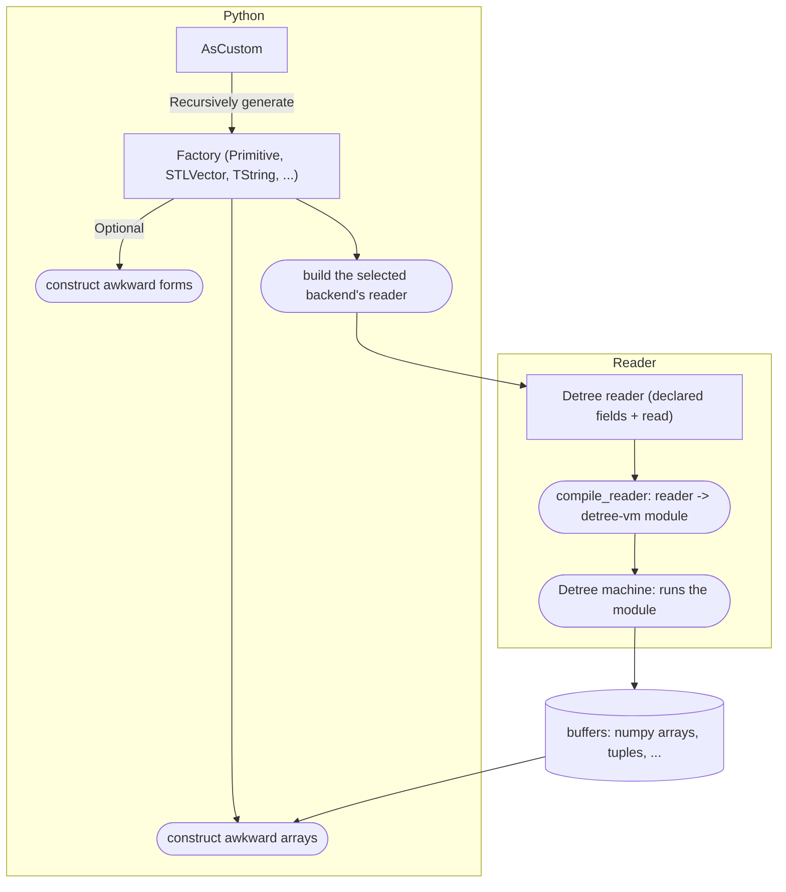

# Introduction

Uproot-custom is an extension of [Uproot](https://uproot.readthedocs.io/en/latest/basic.html) that provides an enhanced way to read custom classes stored in `TTree`.

> [!WARNING]
> Because of earlier mistakes in version management, the `v2.x.x` series should still be treated as a development version rather than a stable release. Please specify a minor version when using Uproot-custom as a dependency (e.g., `uproot-custom==2.5.*`) to avoid unexpected breaking changes.

## What Uproot-custom can do

Uproot-custom can natively read complicated combinations of nested classes and c-style arrays (e.g. `map<int, map<int, map<int, string>>>`, `vector<TString>[3]`, etc), and memberwisely stored classes. It also exposes a way for users to implement their own readers for custom classes that are not supported by Uproot or Uproot-custom built-in readers.

## When to use Uproot-custom

Uproot-custom aims to handle cases that classes are too complex for Uproot to read, such as when their `Streamer` methods are overridden or some specific data members are not supported by Uproot.

## Two technical routes

A downstream project adds readers for the classes its collaboration stores. There are two routes to make such a reader run, and **Detree is the recommended one**:

- **One language.** The read path is Python source, compiled to a detree-vm module; there is no second implementation to port and keep in sync.
- **No ABI.** A C++ reader is built against the Uproot-custom header, a pybind11 minor version and one Python ABI, so it must be pinned and rebuilt. A Detree reader is compiled at run time and has none of those couplings.
- **No build step.** `pip install` is the whole installation; users need no C++ toolchain.
- **Fast enough.** The read path runs as bytecode on the Detree machine, far faster than a Python reader.

The other route is **Python + C++**: write the reader as an `IReader` in Python to get the logic right, then port it to C++ for production. The Python half is slow enough that shipping it is rarely an option, so this route almost always means maintaining both implementations, shipping a compiled extension, and pinning versions. Take it when the read path needs plain Python, or when a branch needs the last measure of speed.

## How Uproot-custom works

Uproot-custom uses a Reader / Factory mechanism to read classes:



- `Factory` is a Python class that matches a class from the streamer information, creates its reader, and post-processes the raw data into `awkward`.
- `Reader` decodes the bytes. With Detree it declares its buffers and sub-readers as fields and writes `read` in Python; the compiler lowers it to a detree-vm module, and the machine executes it for every basket.

This mechanism is implemented as the `AsCustom` interpretation, and the byte-level reader is selected by the reader backend: `detree` for the Detree route, `python` while developing on the Python + C++ route and `cpp` in production. This keeps Uproot-custom well compatible with Uproot.

> [!TIP]
> Users can implement their own Factory and Reader and register them with Uproot-custom. Write a **Detree reader** first; take the **Python + C++ route** when the read path needs plain Python, or when a branch needs more speed than Detree gives. An example downstream project can be found in [the example repository](https://github.com/mrzimu/uproot-custom-example).

## Quick start

```python
import uproot
import uproot_custom as uc

uc.claim("/my_tree:my_branch")

f = uproot.open("file.root")
arr = f["my_tree/my_branch"].array()
```

## System Requirements

- **Python 3.9+**: Uproot-custom supports Python 3.9 through 3.14.
- **C++17 compiler**: only for the C++ stage of the Python + C++ route. Detree readers need no compiler, no CMake and no build step.

## Documentation

View the [documentation](https://mrzimu.github.io/uproot-custom/) for the reader/factory pipeline, the Detree reader reference, and the trade-offs between the two routes. The pages worth starting with:

- [Get started](https://mrzimu.github.io/uproot-custom/getting-started.html)
- [Write a Detree reader](https://mrzimu.github.io/uproot-custom/tutorial/index.html)
- [Choosing a technical route](https://mrzimu.github.io/uproot-custom/concepts/choosing-a-route.html)

> [!NOTE]
> Uproot-custom does not provide a full reimplementation of `ROOT`'s TTree I/O system. Users are expected to implement their own Factory / Reader for their custom classes that built-in factories cannot handle.
